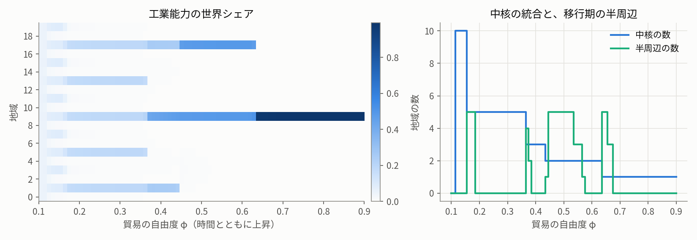
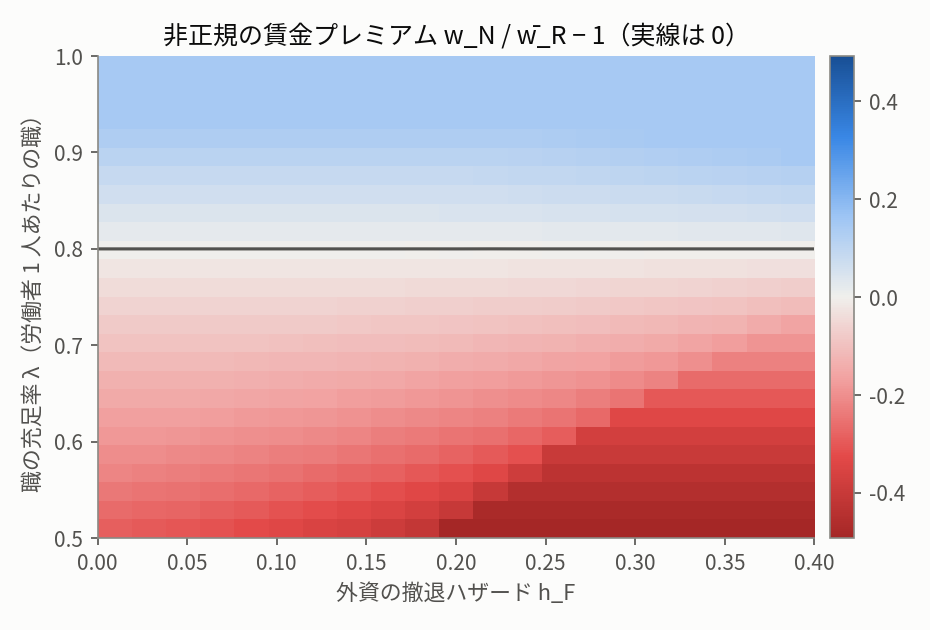
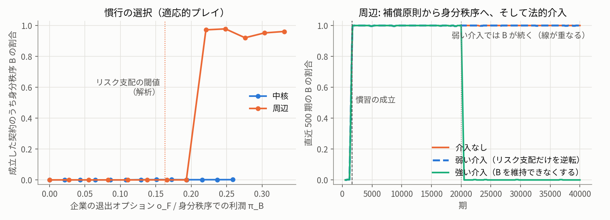

# Matcha を使った neuro-symbolic な法的推論とウォーラーステイン理論

**―― デフォルト論理で読む周辺の非正規労働**

レポートの本体は IPYNB です: **[wallerstein_matcha.ipynb](wallerstein_matcha.ipynb)**（実行済みの出力つき）

> **注意**
> - [Matcha](https://www.elecode.jp/matcha) は花房孟胤氏による法的推論の形式言語です。本リポジトリは、公開されている用例から読み取った文法で Matcha を扱っています。
> - 本リポジトリで使う例外記法 **Matcha-D（`!>` / `>> not`・`>> !` / `:: 優先`、および主張への `as` 名前付け）は非公式の拡張で、Elecode／花房氏とは無関係です**。名前付けの `as`・参照の `$`・見出しの `::`・コメントの `//` は、花房氏の連載の用例にあるものです。
> - 道具一式（構文チェッカ、mext、Claude Code のスキル）は、別のリポジトリ **[JRF-2018/mext](https://github.com/JRF-2018/mext)** にあります。


## これは何か

二つのことを一つのレポートで行っています。

1. **ウォーラーステインの世界システム論をシミュレーションで示す。** 中核・半周辺・周辺はどう分かれるか。その階層の下で、なぜ周辺では非正規の労働が広がり、しかも「リスクを負う非正規ほど高賃金であるべき」という原則が「身分が低いから安くてよい」という慣習に反転するのか。
2. **その結果を、法的推論の形式言語 Matcha に移し、デフォルト論理として分析する。** シミュレーションの数値を確定した事実として Matcha で書き、どの規範がどの事実と力関係に支えられて成り立つかを、デフォルト論理の Extension（矛盾なく保持できる判断のまとまり）として計算します。

出発点は、高校の世界史の図録にある一文です。

> 奴隷や契約労働者など、様々な形の非自由労働が展開した。政治的には、国家機構が弱体化し、外国資本が自由に活動する植民地的な状況がみられる。（『詳説世界史図録』p.167）

「周辺では非正規の労働が広がる」という命題を、シミュレーションで「なぜそうなるか」を示し、形式言語で「それを正当化する規範の構造はどうなっているか」を示す、というのが本レポートの組み立てです。


## neuro-symbolic な法的推論のフレームワーク

本レポートでいちばん伝えたいのは、ウォーラーステインについての個々の結論よりも、むしろそれを導いた**枠組み**のほうかもしれません。

```
シミュレーション ──(決定論的な生成器)──▶ .matcha ──(構文チェック)──▶ 構文木
  （sims/out/*.json）   出典つきの事実                                  │
                                                         (決定論的な変換)
                                                                        ▼
                AI の判断 ──────────────────────────▶ デフォルト理論 (W, R, D, <)
   （同一視・否定・あてはめの審査。                                     │
     すべて理由つきで [ai] に記録）                    Extension の全列挙・preferred の選択
                                                                        │
                                                                        ▼
                                              Lean による証明（各 Extension が Reiter の
                                              Extension であること。健全性定理つき）
```

法的な推論には、二種類の仕事が混ざっています。

- **ことばの仕事**: 「この二つの文言は同じことを言っているか」「この事実は、この要件にあてはまると評価してよいか」。これは本質的に曖昧で、文脈と常識に依存します。ここは大規模言語モデル（neuro）が得意とするところです。
- **論理の仕事**: 「これらの規範と例外と優先順位から、何が結論として導かれるか」「その結論はどの前提に支えられ、何を崩せば崩れるか」。これは一度ことばの仕事が済めば、機械的に決まります（symbolic）。

本レポートの枠組みは、この二つを**ファイルの上で物理的に分けます**。AI の判断はすべて MEXT ファイル（考案した Extension の記述言語）の `[ai]` 節に、理由とともに一行ずつ書かれます。それより下は、AI の判断から独立に、決定論的なプログラムが計算し、Lean が証明します。AI の判断を一行変えれば、結論がどう変わるかも、その場で再計算できます。

この形は、法律にも、ウォーラーステインにも限りません。

- 主張・要件・例外・優先順位で書ける議論なら、何にでも使えます。スキルの試験では、民法の答案のほか、花房氏のブログにあるカントの論証（法律以外の論証）にも適用しました（`tests/skill_runs/`）。
- 事実の側をシミュレーションが供給し、規範の側を形式言語が受け持つ、という分業も一般的です。経済モデル、疫学モデル、気候モデルの結果を、政策や法の議論に「出典つきで」接続する道筋として使えるはずです。
- 「AI が考え、プログラムが確かめ、証明支援系が保証し、人が監査する」という役割分担は、AI を責任ある判断に使うときの、一つの現実的な型になりうると考えています。

もちろん、これは試作です。扱えるのはリテラル型の命題デフォルト理論で、Matcha には変数がないので規範は事件ごとに具体化しています。Extension の列挙が漏れなくなされていること（完全性）は、まだ Lean では示していません。それでも、**曖昧なものを曖昧なまま、どこが曖昧かを正確に指させる形で扱える**ことは、この枠組みの確かな強みだと考えます。

実を言えば、作り始めたときには、Matcha からデフォルト理論への変換がここまで決定論的に書けるとは、文責者自身も思っていませんでした。Matcha の「要件」を必要十分条件として読み、例外 `!>` を優先順位と正当化の阻却として読む、といった少数の約束で、AI の判断を要する箇所を `[ai]` の数行にまで押し込めることができました。


## 形式化の意義: 機械「的」に変換された部分を人が追えること

本レポートの設計原理は、**機械「的」に変換されたものの部分を人が追いやすいことに、形式化の意義がある**、という点にあります。

形式化というと、「機械が正しさを保証してくれる」ことが期待されがちです。しかし法的な推論でも社会科学の議論でも、本当に争われるのは、事実をどう評価したか、どの規範を優先したか、といった形式の外の判断です。形式化はそれを消してはくれません。形式化にできるのは、**形式の外の判断がどこにあり、それが結論にどう効いているかを、誰でも追える形にすること**です。

そのために、本レポートでは次のようにしています。

- シミュレーションの数値から Matcha の事実への変換は、決定論的なスクリプト（`argument/build_argument.py`）で行い、各事実の直前のコメントに出典（どの JSON のどの値か）を書きます。
  - この生成器は汎用の道具ではなく、本レポートのためだけのコードです。それでも生成器を介したのは、**AI を使うけれども、システムにはできる限り AI が生成した決定論的コードを使い、後から検証（注意労働）できるようにしておく**のが、これからのセオリーだと考えるからです。
- AI の判断（命題の同一視、否定、事実から評価へのあてはめ）は、すべて `[ai]` 節に理由とともに書きます。審査を反映しない版や、判断を変えた試算も残します。
- Extension の計算、導出の根拠の説明（`mext explain`）、Lean の証明は、AI の判断から独立に再現できます。

その結果、本レポートの結論の弱点も、行番号と原子の名前で特定できるようになりました（IPYNB §12）。たとえば「周辺では身分秩序が通る」という結論は、外資の安定した職の非正規の割合 0.497 を「正規が通常でない」と評価したこと、窮迫による受け入れを民法 92 条の「慣習による意思」と読んだこと、そして力関係から来る優先順位に支えられています。反論する側が何を立証すればよいかも、同じように特定できます。


## 主な結論

- **(a) デフォルトとは立証責任の配分である。** 「中核が原則、周辺が例外」という書き方と、それを反転した書き方は、事実の分かっている地域ではまったく同じ結論を出します。違うのは、事実の分からない地域だけです。デフォルトと例外の割り当ては事実からは決まらず、どちらに立証を負わせるかという規範的な選択（中核の視点）によって選ばれています。
- **(b) 市場が規範の適用の前提を決め、力が規範の間の優先順位を決める。** 補償原則と身分秩序の対立は、論理の内部では決まりません（二つの preferred Extension に分かれる）。賃金の序列が反転するかどうかは労働余剰だけで決まり（Sim 2）、どちらの慣行が定着するかは資本の退出オプションで決まります（Sim 3）。
- **(c) 当為と存在の食い違いが、形式的に表れる。** 均等待遇（パート有期法 9 条）は強行規定として、当為の層では身分秩序に優ります。しかし執行が弱ければ、存在の層では慣行が続きます。「法の上では許されないが、事実としては切り下げが続く」状態が、二つの層の結論の食い違いとして現れます。
- **(d) アブダクション。** 観測された慣行を説明できる規範の組は、事実を要件とする慣習と、力から来る優先順位を併せたものだけでした。


## シミュレーション

すべて numpy と matplotlib だけで動きます（合計で約 1 分）。要約は [sims/SUMMARY.md](sims/SUMMARY.md) にあります。

### Sim 1: 中核／半周辺／周辺の創発

累積的因果（Myrdal・Kaldor。Krugman & Venables 1995 と同じ型）のモデルです。輸送の費用が下がる（φ が上がる）と、対称な状態は φ\* ≈ 0.184 で崩れ、中核と周辺に分かれます。グローバル化の経路では、中核は 10 → 5 → 3 → 2 → 1 と統合されていき、半周辺は統合の移行期（没落しつつある中核と、上昇しつつある周辺）にだけ現れます。



### Sim 2: 周辺における非正規雇用

Harris–Todaro 型の二重労働市場に、外資の撤退ハザードを入れたモデルです。賃金の序列が反転する（補償賃金 → 身分賃金）条件は、q < 1 − e₀ ⟺ λ < 1 − e₀ となり、**労働余剰だけで決まります**（非正規の割合が式から消えます）。資本の移動性が決めるのは、非正規の「量」と、中核への移転の大きさです。



### Sim 3: 事実から慣習規範へ

Young (1993) の適応的プレイによる協調ゲームです。中核では身分秩序は均衡になりません。周辺では両方の慣行が均衡になり、どちらが確率的に安定かは企業の退出オプションで決まります（リスク支配の閾値は o_F ≈ 0.052）。補償原則から出発しても、約 1,600 期で身分秩序の慣習が成立します。弱い法的介入では慣習の慣性で慣行が続き、強い介入では崩れます。



日本の「失われたウン十年」についての「内なる周辺化」は、Sim 2 の仮説の例示として触れるにとどめています。


## Matcha、Matcha-D、MEXT

### Matcha

[Matcha](https://www.elecode.jp/matcha) は、主張・根拠・要件・定義・事実・評価・論点・結論を記号で書く、法的推論の形式言語です。司法試験の答案構成を形式化したもの、と言えます。

```
#傷害罪^刑法204条 <= 甲がAを殴打した行為: (
    「人の身体を傷害した」 <= Aは全治2週間の打撲を負った
    %故意^38条1項本文 <= 甲はAを殴るつもりだった
) >> 甲に傷害罪が成立する
```

### Matcha-D（非公式の拡張）

Matcha には例外を明示する記法がないので、デフォルト論理として読むための最小限の拡張を加えました。

```
#飛行^鳥の通念 <= トゥイーティー: (
    %鳥である <= トゥイーティーは鳥である
) >> トゥイーティーは飛ぶ as 鳥は飛ぶ

#非飛行^ペンギンの通念 <= トゥイーティー: (
    %ペンギンである <= トゥイーティーはペンギンである
) >> !トゥイーティーは飛ぶ as ペンギン例外 !> $鳥は飛ぶ
```

- `as ラベル`: 主張に名前を付けます（`as` と `$` は原典にある名前付けと参照の記法で、Matcha-D はそれを主張にも使います）。
- `!> $ラベル`: その主張が、ラベルの主張の例外であることを示します（優先順位と、正当化の阻却）。
- `>> not 結論`（`>> !結論` も同じ）: 結論の否定です。
- `:: 優先 $a > $b`: 例外ではない優先順位を、外から与えます。

### MEXT（Matcha EXTension notation）

Extension を記述するために考案した言語です。三つの層に分かれています。

- **人と AI が書く部分**: `[ai]`（同一視・否定・あてはめの審査の判断と理由）、`[extra]`（補う事実や規則）、`[claimed]`（検証したい Extension の予測）。
- **プログラムが生成する部分**: 原子の表（各原子が原文の何行目から来たか）、W、規則、デフォルト、優先順位、Extension の一覧、懐疑的・信憑的帰結。
- **検証**: `[claimed]` と計算結果の照合、Lean による証明。

上のトゥイーティーの例では、Reiter の Extension が 2 個、preferred Extension が 1 個（ペンギン例外が勝つ）になります。詳しくは mext リポジトリの [docs/mext.md](https://github.com/JRF-2018/mext/blob/master/docs/mext.md) を見てください。

### スキル matcha-default-extensions

Claude Code のスキルで、`.matcha` を受け取り、構文チェック → ひな形の作成 → AI の判断の記録 → Extension の予測 → 求解・検証・Lean → 「論証は正しいか」のレポート、という手順を踏みます。レポートでは、形式的妥当性（論理として正しいか）と実質的妥当性（あてはめは妥当か）を分けて論じます。

```
/mext:matcha-default-extensions argument/T1_employment.mext
```

（プラグインとして入れた場合。スキルのディレクトリを `.claude/skills/` にコピーした場合は `/matcha-default-extensions` です。）


## Lean による検証

Lean 4 と Mathlib で、次のことを示しています（`WallersteinTheory/`）。依存する公理は Lean の標準の 3 つ（propext、Classical.choice、Quot.sound）だけで、`sorry` はありません。

- Sim 1〜3 の解析的な補題（逆 U 字形、反転の条件、リスク支配の単調性など）。
- MEXT の検査器の健全性定理: Bool の判定 `isExtension T E = true` から、Reiter の Extension の定義が従うこと。
- 第 3 部の各理論の各 Extension が、Reiter の Extension であること（`decide +kernel`）。


## 実行の仕方

```bash
git clone https://github.com/JRF-2018/wallerstein_theory
cd wallerstein_theory
pip install numpy matplotlib git+https://github.com/JRF-2018/mext@v0.1.0
jupyter notebook wallerstein_matcha.ipynb
```

- AI の審査（任意）には Claude Code CLI とスキルが要ります。

  ```bash
  claude plugin marketplace add JRF-2018/mext#v0.1.0
  claude plugin install mext@jrf-mext
  ```

  ノートブックは既定では、保存済みの CLI の出力（`notebook_runs/`）を表示します。`RUN_CLAUDE = True` にすると実際に呼びます。
- Google Colab では、ターミナルで `BIN_DIR=/usr/local/bin curl -fsSL https://claude.ai/install | sh` を実行して Claude Code CLI を入れ、一度 `claude` を起動して認証しておきます。
- Lean の検証（任意）には elan が要ります。`lake exe cache get` で Mathlib のキャッシュを取得してから `lake build` します。


- このレポートは mext の **v0.1.0**（タグ）で作りました。後の版で出力が変わらないよう、上のように版を固定して入れてください。

なお mext 0.2.0 以降には、任意の文書の論証を Matcha に書き起こして分析するスキル「mext分析」「matcha分析」があります。「https://github.com/JRF-2018/mext を使って、この文書を mext分析してください」と AI に頼めば使えます（詳しくは [mext の README](https://github.com/JRF-2018/mext)）。


## ファイルの構成

| パス | 内容 |
|---|---|
| `wallerstein_matcha.ipynb` | レポートの本体（実行済み） |
| `notebook/` | IPYNB を生成するスクリプト（`build_notebook.py`）と、実行するスクリプト（`run_notebook.py`） |
| `sims/` | シミュレーション（Sim 1〜3）、図（`fig/`）、数値（`out/`）、要約（`SUMMARY.md`） |
| `argument/` | 第 3 部の生成器（`build_argument.py`）、生成した `.matcha`、理論の `.mext`、分析（`ANALYSIS.md`）、AI の審査の記録 |
| `notebook_runs/` | IPYNB で表示する、スキルの CLI 実行の記録 |
| `examples/` | Matcha-D の例題 |
| `tests/` | 構文チェッカのテストのコーパスと、スキルの試験の記録 |
| `WallersteinTheory/` | Lean の証明 |
| `docs/` | 文法、MEXT の仕様、[参考文献](docs/references.md)、会話ログ（[Grok](docs/grok_conversation-20261012.md)、[Gemini](docs/gemini_conversation-20261016.md)） |

`tests/corpus/` などには、Elecode「Matchaとは」と花房孟胤氏のブログの Matcha コードを、試験のために引用しています（各ファイルの先頭に引用元を記しています。著作権は原著者に帰属します）。


## 参考文献

主なものは次のとおりです。全体は [docs/references.md](docs/references.md) にあります。

- I. Wallerstein, *The Modern World-System I*, Academic Press, 1974.
- I. Wallerstein, *World-Systems Analysis: An Introduction*, Duke University Press, 2004.
- 川北稔 編『知の教科書 ウォーラーステイン』講談社選書メチエ, 2001.
- R. Reiter, "A Logic for Default Reasoning", *Artificial Intelligence* 13, 1980.
- G. Brewka & T. Eiter, "Preferred answer sets for extended logic programs", *Artificial Intelligence* 109, 1999.
- J. R. Harris & M. P. Todaro, "Migration, Unemployment and Development: A Two-Sector Analysis", *American Economic Review* 60, 1970.
- H. P. Young, "The Evolution of Conventions", *Econometrica* 61, 1993.
- 花房孟胤「法律には形式言語がない」（連載）, https://t.hanafusa.works/ja/legal-reasoning-language/1/


## Author (文責)

JRF ( http://jrf.cocolog-nifty.com/statuses , Twitter (X): @jion_rockford )


## AI

Claude Opus 5.5 がほとんどを書いた。Lean の健全性定理の証明の一部は Claude Sonnet 5.5 のサブエージェントが書いた。Grok 4.7 および Gemini 3.6 Flash との会話も参考にしている。


## ライセンス

MIT License（[LICENSE](LICENSE)）.
